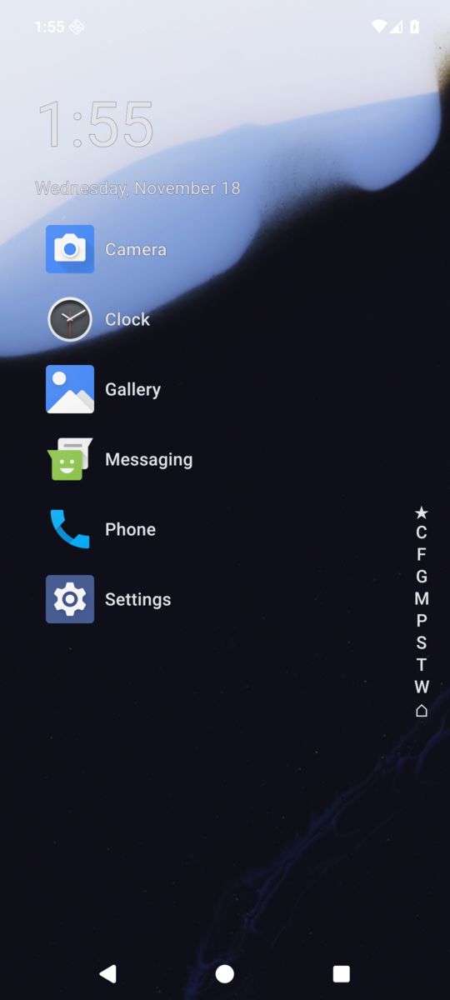
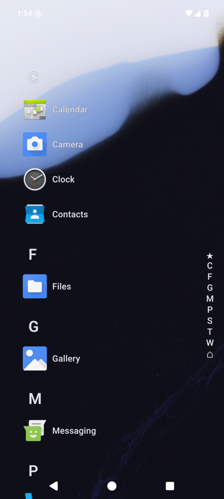
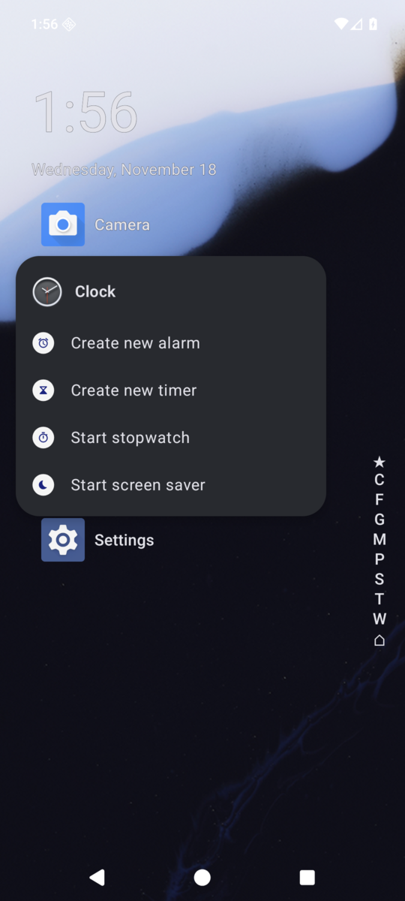
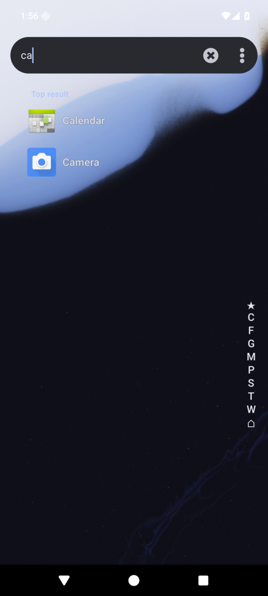
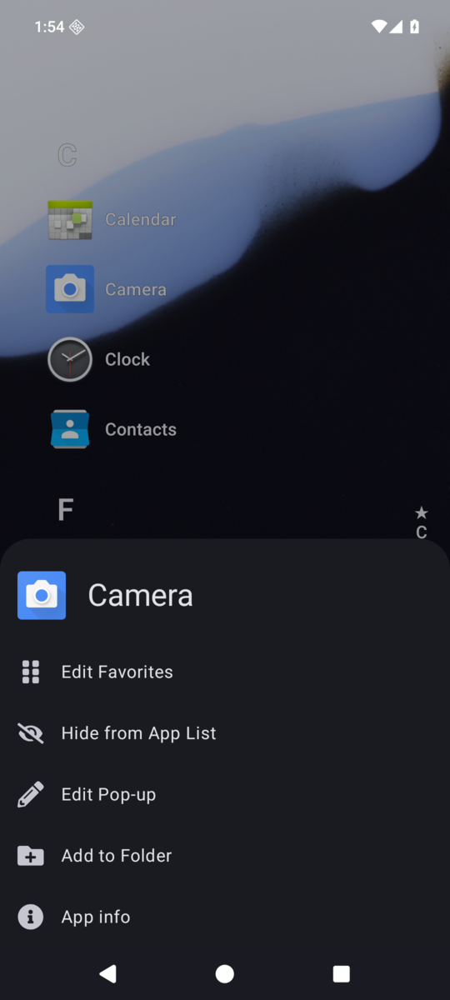
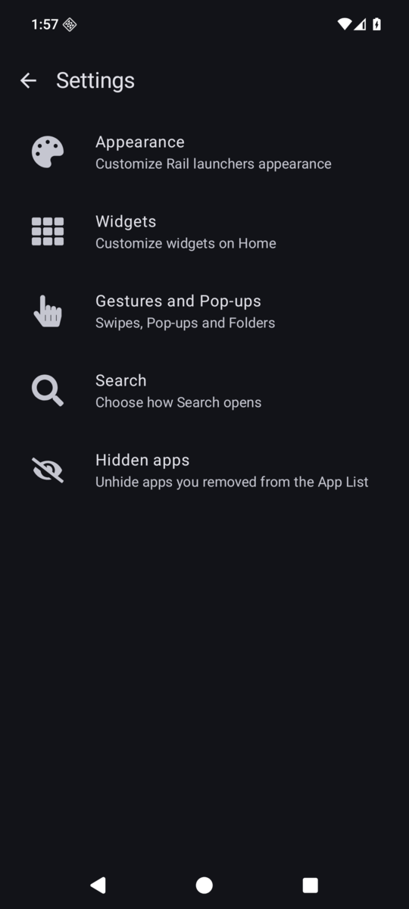

# Rail

Rail is a list-based home-screen launcher for Android, inspired by
Niagara. Home shows a clock and your Favorites; everything else lives in
an alphabetical App List you reach by scrubbing the letter Rail on the
screen edge.

Rail is in alpha. Until the first stable release, an update may reset
your Favorites, widgets and settings.

<p>
  
  
  
</p>
<p>
  
  
  
</p>

## Features

- **Home**: clock and date Header in several styles, battery and upcoming
  events, and a Favorites list you reorder in Edit Favorites.
- **The Rail**: a letter index on the right or left edge. Scrub it to
  jump through the App List; the star returns to Home.
- **App List**: sort alphabetically, by most used or by recently used.
  Rename any app or give it an icon from an icon pack or your gallery.
- **Pop-ups**: swipe right on an app to see its notifications, shortcuts
  and widgets, and add your own apps and shortcuts to it.
- **Folders**: Folders open as Pop-ups and can sit on Home, in the App
  List, or both.
- **Widgets**: add any number of widgets to Home, group them into Widget
  Stacks, or replace the Header. A media player appears while music
  plays.
- **Search**: swipe up or start typing. Search matches apps, shortcuts,
  Folders and contacts, includes a calculator, and offers web search
  with your choice of engine.
- **Profiles**: work apps show inline with a badge, and Private Space
  appears as a lockable section at the end of the App List.
- **Hidden apps**: hide apps from the App List and still find them in
  Search.

Rail has no built-in weather. For weather on Home, add a widget from
[Breezy Weather](https://github.com/breezy-weather/breezy-weather).

## Install

Download the APK from
[GitHub Releases](https://github.com/frap129/rail-launcher/releases),
install it, then choose Rail as your default home app. Rail requires
Android 12L (API 32) or later.

## Development

Requires Nix with flakes enabled. The dev shell provides JDK 21, Android SDK 37, build-tools 36 and 37, `adb`, and Node.js:

```sh
nix develop
./gradlew :app:assembleDebug
```

For an emulator, use the `emulator` shell only when no physical device is in use. It creates the `rail-api36` AVD on first entry and provides `rail-emulator`:

```sh
nix develop .#emulator
rail-emulator
```
